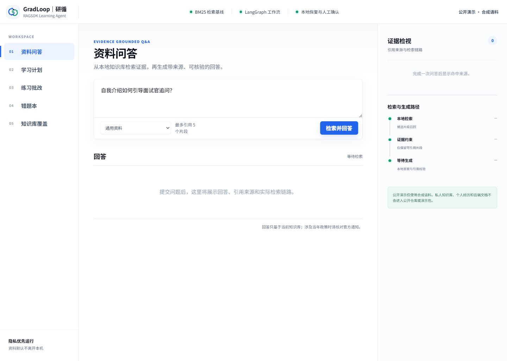
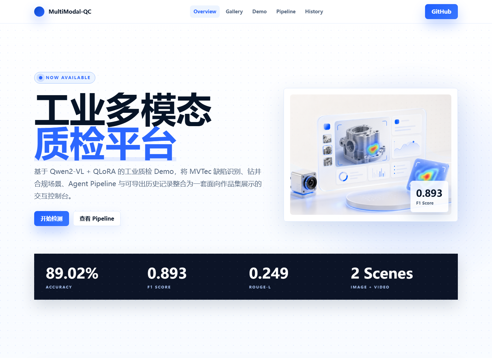
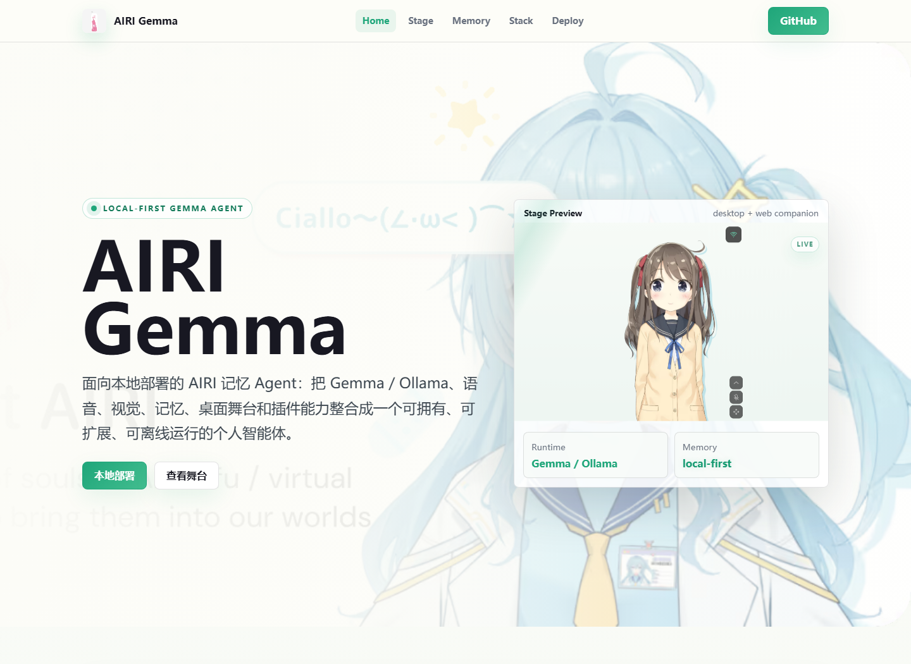
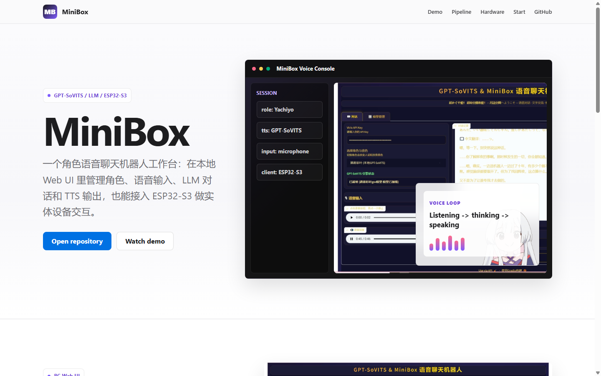
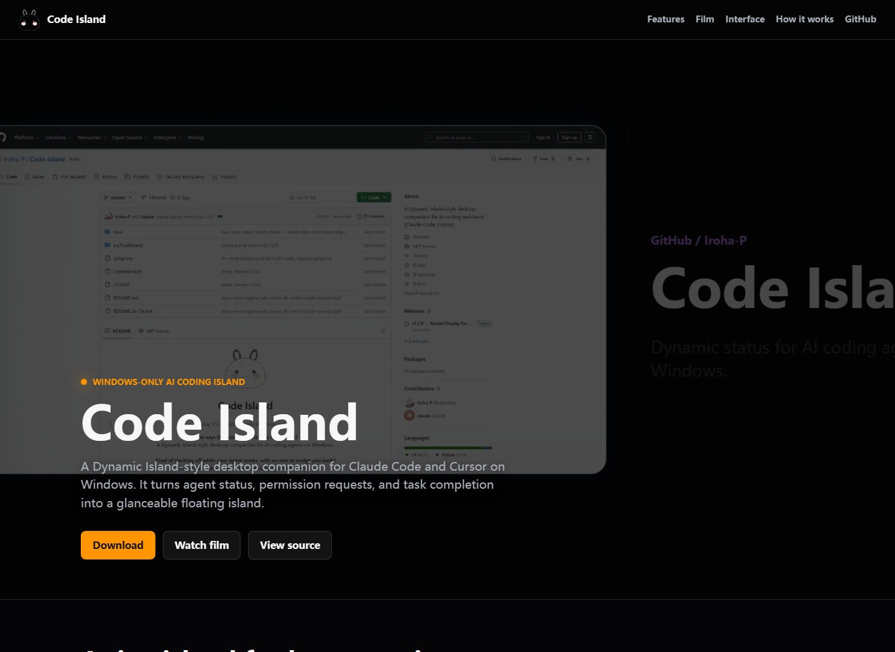
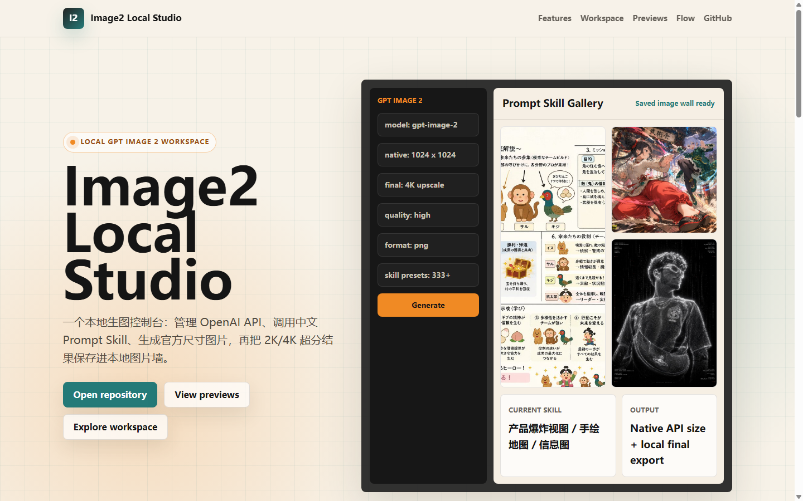

<div align="center">

# Wednesday / Iroha-P

**AI 产品思考 · 大模型应用开发 · Agent · 多模态**

从知识检索与工作流编排，到模型微调、语音交互与开发工具。

[](https://iroha-p.github.io/)
[](#精选项目)
[](#精选项目)

**[访问在线作品集](https://iroha-p.github.io/)** · **[精选项目](#精选项目)** · **[技术专题](#技术专题)** · **[GitHub](https://github.com/Iroha-P)**

</div>

---

## 精选项目

<h3>GradLoop</h3>
<a href="https://iroha-p.github.io/projects/gradloop/">
  
</a>
<p><strong>RAG 学习与面试训练 Agent</strong></p>
<p>证据引用、LangGraph 工作流、人工确认与学习复盘。应用工程与模型实验独立维护。</p>
<p><code>RAG</code> <code>LangGraph</code> <code>FastAPI / SSE</code></p>
<p><a href="https://iroha-p.github.io/projects/gradloop/">项目介绍</a> · <a href="https://gradloop-ragsdk-omni.pages.dev/">公开 Demo</a><br><a href="https://github.com/Iroha-P/gradloop-ragsdk-omni">应用源码</a> · <a href="https://github.com/Iroha-P/gradloop-ragsdk-omni-training">模型实验</a></p>
<br clear="all">

<h3>MultiModal-QC</h3>
<a href="https://iroha-p.github.io/MultiModal-QC/">
  
</a>
<p><strong>工业图文质检与模型微调</strong></p>
<p>Qwen2-VL + QLoRA 缺陷识别与描述，结合传统分类基线、Agent Pipeline 和检测记录。</p>
<p><code>Qwen2-VL</code> <code>QLoRA</code> <code>Gradio</code></p>
<p><a href="https://iroha-p.github.io/MultiModal-QC/">项目介绍</a> · <a href="https://github.com/Iroha-P/MultiModal-QC">源码与评测</a></p>
<br clear="all">

<h3>AIRI Memory Agent</h3>
<a href="https://iroha-p.github.io/airi-gemma/">
  
</a>
<p><strong>本地优先的长期记忆 Agent</strong></p>
<p>基于 AIRI 的扩展，探索长期记忆、RAG、知识审核与 LoRA 候选数据链路。</p>
<p><code>Gemma / Ollama</code> <code>Memory</code> <code>RAG</code></p>
<p><a href="https://iroha-p.github.io/airi-gemma/">项目介绍</a> · <a href="https://github.com/Iroha-P/airi-gemma">扩展仓库</a> · <a href="https://github.com/moeru-ai/airi">AIRI 上游</a></p>
<br clear="all">

<h3>MiniBox</h3>
<a href="https://iroha-p.github.io/MiniBox/">
  
</a>
<p><strong>角色语音交互与实体硬件</strong></p>
<p>串联语音输入、LLM 对话与 GPT-SoVITS 语音合成，并接入 ESP32-S3 实体设备。</p>
<p><code>GPT-SoVITS</code> <code>LLM</code> <code>ESP32-S3</code></p>
<p><a href="https://iroha-p.github.io/MiniBox/">项目介绍</a> · <a href="https://github.com/Iroha-P/MiniBox">源码与演示</a></p>
<br clear="all">

<h3>Code Island</h3>
<a href="https://iroha-p.github.io/Code-Island/">
  
</a>
<p><strong>Windows AI Coding 桌面工具</strong></p>
<p>在桌面集中查看 AI 编程助手状态、处理权限请求，并接收任务完成提醒。</p>
<p><code>Windows</code> <code>.NET / WPF</code> <code>Agent Hooks</code></p>
<p><a href="https://iroha-p.github.io/Code-Island/">项目介绍</a> · <a href="https://github.com/Iroha-P/Code-Island">源码与下载</a></p>
<br clear="all">

<h3>Image2 Local Studio</h3>
<a href="https://iroha-p.github.io/image2-local-studio/">
  
</a>
<p><strong>本地 API 生图工作台</strong></p>
<p>整合生图参数、中文 Prompt Skills、本地超分和图片墙，API 配置保存在本机。</p>
<p><code>Node.js</code> <code>Image API</code> <code>Prompt Skills</code></p>
<p><a href="https://iroha-p.github.io/image2-local-studio/">项目介绍</a> · <a href="https://github.com/Iroha-P/image2-local-studio">源码与启动</a></p>
<br clear="all">

预览图来自公开演示界面或项目展示页；在线体验、功能实现与模型评测的范围，以对应仓库说明为准。

## 技术专题

GradLoop 的四个专题，从系统结构逐步展开到检索、工作流与模型评测。

| 专题 | 主要内容 |
| --- | --- |
| [项目与架构](https://iroha-p.github.io/projects/gradloop/) | 产品定位、六层职责与工程边界 |
| [知识与 RAG](https://iroha-p.github.io/projects/gradloop/rag.html) | 摄取与隐私分区、BM25、证据门控、RAGSDK 适配 |
| [Agent 工作流](https://iroha-p.github.io/projects/gradloop/agent.html) | 状态图、固定工具、人工中断、checkpoint、SSE |
| [模型与评测](https://iroha-p.github.io/projects/gradloop/models.html) | 数据划分、Ascend Base / LoRA、协议差异与人工双评 |

GradLoop 公开 Demo 使用合成语料；模型实验结论见[固定评测报告](https://github.com/Iroha-P/gradloop-ragsdk-omni-training/blob/main/docs/stage-b-npu-results-2026-07-29.md)。Fork 与上游扩展单独注明，连通性检查与模型效果分别报告。

## 仓库维护

本仓库承载 GitHub Pages 静态作品集，使用原生 HTML、CSS 和 JavaScript。

<details>
<summary><strong>本地预览与检查</strong></summary>

安装 Node.js 后，在仓库根目录执行：

```sh
node --check portfolio.js
node --check script.js
node --check projects/gradloop/script.js
node --test tests/*.test.cjs
```

使用静态 HTTP 服务预览仓库根目录。部署配置、项目索引同步逻辑、内容更新与验证约定见[维护指南](docs/maintenance.md)。

</details>

[内容与发布维护](docs/maintenance.md) · [内容更新记录](docs/content-update-20261009.md) · [视觉验收记录](design-qa.md)

---

<div align="center">

<strong><a href="https://iroha-p.github.io/">浏览完整作品集</a></strong> · <a href="https://github.com/Iroha-P?tab=repositories">查看全部公开仓库</a>

</div>
